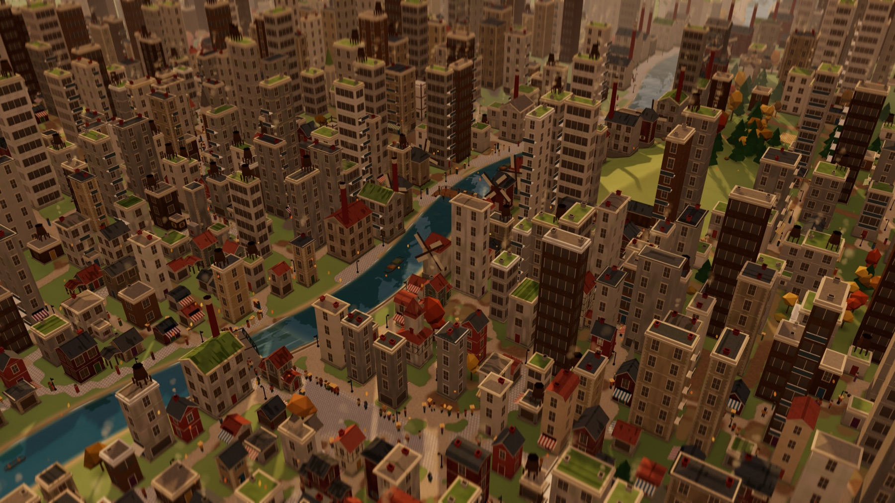
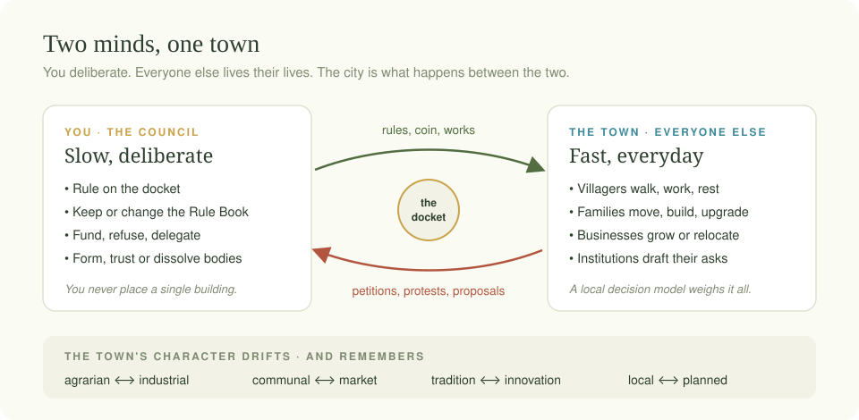
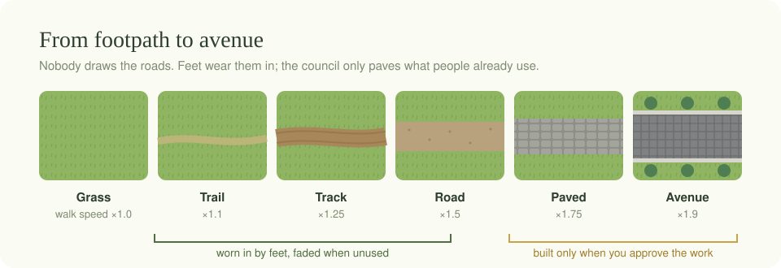
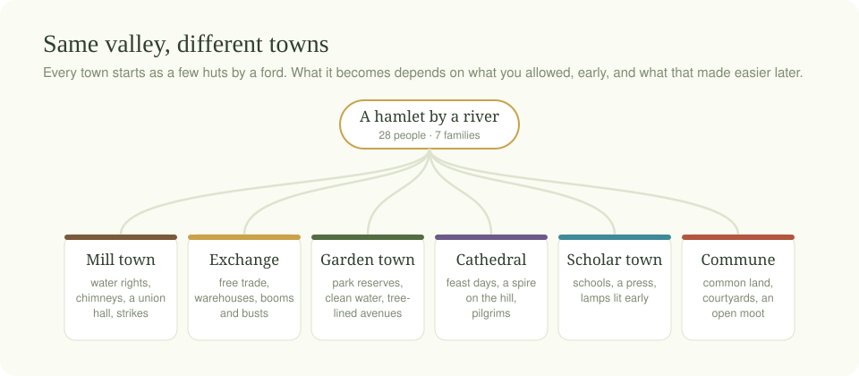
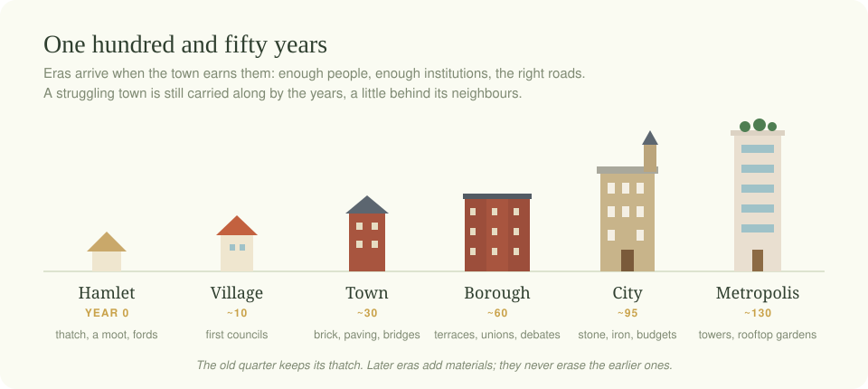
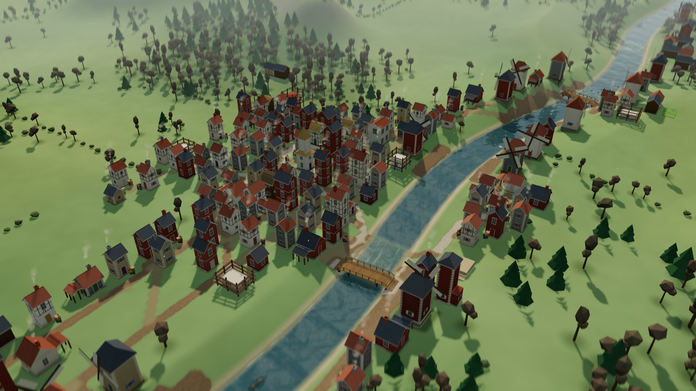
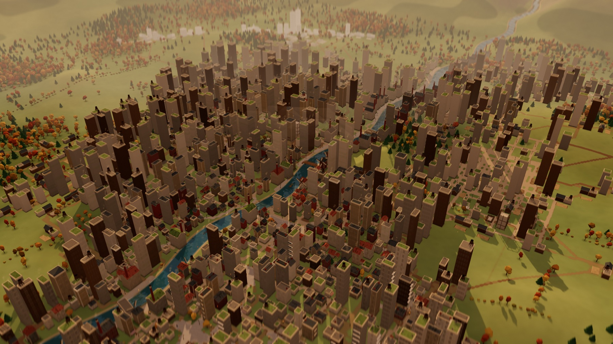
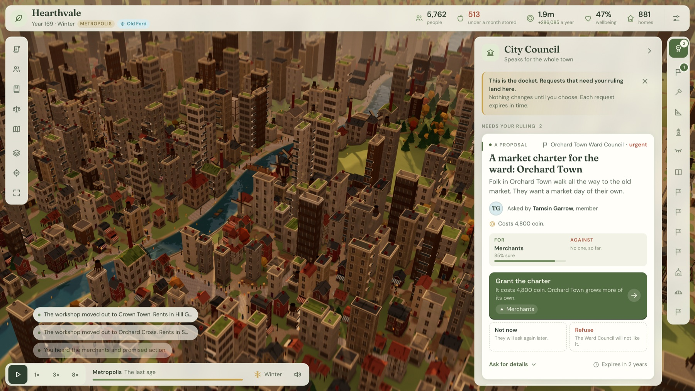
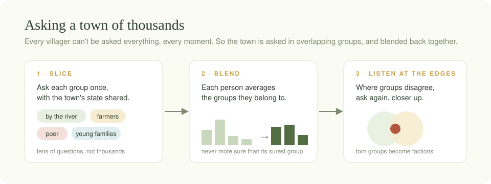
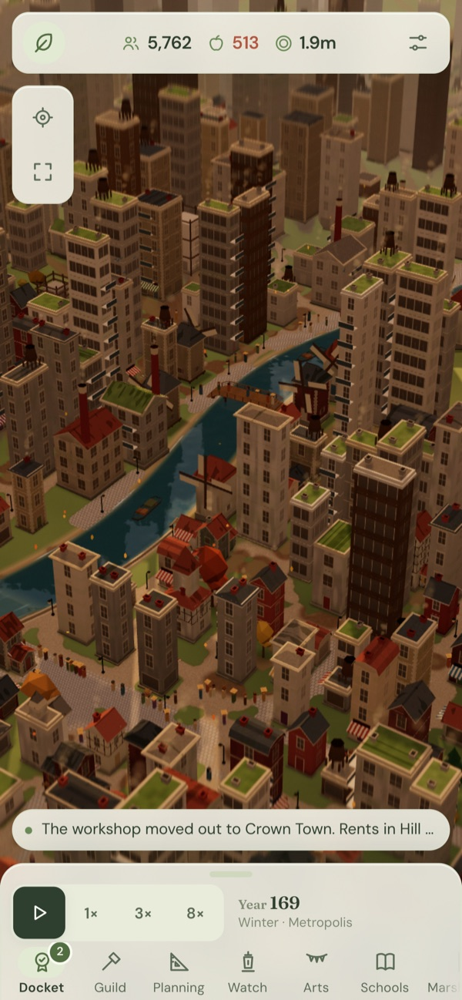

<p align="center">
  
  <br><sub>Year 169 of one player's valley: a mill town that became a metropolis.</sub>
</p>

<h1 align="center">Hearthvale</h1>

<p align="center"><em>A town that grows into a city over 150 years, and remembers every choice you made along the way.</em></p>

---

Hearthvale is a quiet game about leading a place without controlling it.

You begin with seven families and a few thatched huts beside a river ford. You will never place a building, draw a road or point a villager anywhere. You sit on the council. People bring you their requests: a granary before winter, a bridge where the ford floods, a school for the clerks' children. You decide. Then you watch the town live with what you decided.

Over a century and a half, footpaths harden into streets. A second village grows on the far bank. Farmers ask for their own council, and later disagree with it. Rents climb in the centre and the old workshops move out. By the end you are governing a city of thousands, with a rule book full of compromises and a chronicle that reads like its history. Play again from the same valley and you will get a different city.

## Two minds, one town

<p align="center"></p>

The game borrows an old idea about how people think: one mind that is slow and deliberate, and another that is quick and everyday.

**You are the slow mind.** You read the docket, weigh what each group of the town wants, and rule. **The town is the quick mind.** Thousands of small decisions happen without you: where to walk, whether to move, when to expand the bakery, whether to join the strike. Those everyday choices come from a decision model running on a local GPU. It weighs a household's savings, the price of bread, the rules in force and the mood of the street, all at once.

Neither mind is in charge. Your rules shape what the town finds easy, and the town's behaviour shapes what lands on your desk next.

## Nothing is placed. Everything grows.

<p align="center"></p>

There is no build menu. Roads appear where people actually walk. Each step wears the grass a little, and a well-used line becomes a trail, then a track, then a road. Paths nobody uses fade back to meadow. Homes cluster along the busiest lines, which makes those lines busier still. That loop is why a Hearthvale town looks grown rather than drawn.

The same goes for everything else. Families pick their own plots. Businesses find their own sites, and move out when the rent gets too high. When folk keep wading across a ford, someone lays planks across it. When the planks aren't enough, the River Authority asks you for a proper bridge. Your power is to approve, refuse, fund and set the rules. Where things go is up to the town.

## A town with a memory

<p align="center"></p>

Every ruling nudges the town's character along a few slow axes: farming or industry, common land or open markets, tradition or innovation, local say or central planning. These axes have momentum. A town that has leaned one way for decades keeps leaning that way, and turning it costs more than starting fresh would have. People grumble about rules that go "against the grain".

Nothing in the game follows a script. Unlocks are built from conditions that combine. When the farms grow numerous and the food rules pile up, the farmers petition to form an Agricultural Council. If you refuse, they remember. If you accept, the council starts drafting its own proposals and arguing with the Guild over the same land. Over many runs, towns become mill towns, cathedral towns, garden towns or merchant exchanges, and nobody chose that from a list.

## One hundred and fifty years

<p align="center"></p>

A year passes in about a minute, so a whole chronicle takes an evening. Each new era widens the town's horizons. Stone and brick arrive, then terraces, then civic halls and iron bridges, and finally towers with gardens on their roofs. The old quarter keeps its thatch, so a 150-year-old city still shows the hamlet it started as.

<table>
<tr>
<td width="50%"></td>
<td width="50%"></td>
</tr>
<tr>
<td align="center"><sub><b>Year 30.</b> A market town of 783 people, one bridge, the first councils.</sub></td>
<td align="center"><sub><b>Year 169.</b> 5,762 people across seven neighbourhoods, seven bridges, fourteen councils.</sub></td>
</tr>
</table>

## The council chamber

<p align="center">
<br><sub>Year 169. A neighbourhood that grew into its own town now has its own ward council, and it wants a market day of its own.</sub></p>

The interface starts nearly empty and grows with the town. At first it's one council and a few numbers. As institutions form, each one takes its own place in the side dock, with its own dashboard, docket and budget. Each card says who is asking, why now, and what each choice costs. Small chips show which groups will cheer and which will grumble. You can ask a body to handle its own affairs, give it standing orders, or dissolve it.

The writing aims to be easy to read: short sentences, plain words, a little warmth.

> *"Five times you have put us off. From the tolls to the grain, we wait. Wheel Row is hungry for a voice that knows the soil, not just the ledger."*
> — Osric Lark, asking for an Agricultural Council

## A city of many voices

<p align="center"></p>

You can't ask every villager everything, every moment, and you don't need to. Hearthvale asks the town in overlapping groups: riverside families, farmers, the poor, young parents. Each person blends the answers of the groups they belong to. Where those groups pull in different directions, the game asks again, closer up. Those torn groups are often where tension comes from. Factions split. Petitions begin. Strikes start at the mill gates.

Tap anyone in the town and you can read a short note about them. A language model writes it from the facts of their life and your past rulings:

> *"You approved the apprenticeship step-up and guild price rise, which helped the makers. The free trade rule you set four years ago still hurts them."*

## Anywhere

<table>
<tr>
<td width="62%">

Hearthvale runs in the browser and is built to be light. It draws thousands of buildings and villagers with a handful of draw calls, and drops to a calmer frame rate when you are only watching.

On a phone, the council folds into a bottom sheet with every view one tap away. Add it to your home screen to play full screen.

When the decision model or the writer isn't available, the town keeps living on simple local rules and template text. It just loses some of its nuance.

</td>
<td width="38%"></td>
</tr>
</table>

## Play

```sh
npm install
npm run dev
```

Then open <http://127.0.0.1:5173>. You need a browser with WebGL 2.

The local decision model and narrator are optional. To connect them, copy `local.env.example` to `local.env` and add your key. The key stays on your machine's server and never reaches the browser.

The town can also think for itself without the model: open the game with `?student=1` and a small student model, trained to copy the decision model, answers most questions right in your browser. How it was built and how closely it matches is in [the decision students paper](docs/design/decision-students-paper.html).

**A few controls:** drag to look around and scroll to zoom. `Space` pauses, `C` opens or closes the docket, `F` toggles full screen, and `H` hides the interface so you can just watch.

---

<p align="center"><sub>Built with Three.js and plain JavaScript, no framework. Developers: start with <a href="HANDOFF.md">HANDOFF.md</a>.</sub></p>
