# Graphics review (2026-10-22)

A look at the renderer (`src/render/`) driven by what the owner saw in play:
- window glow around doors at night;
- low-resolution, pixelated ground (dirt, grass, gravel);
- gaps in tree crowns as they move in the wind;
- faceted, oddly shaded valley edges;
- windmills in arbitrary places;
- building on steep hill faces.

Four small fixes are in this branch. The rest are proposals, ranked by value for effort.

**Method.** Screenshots come from `src/render/dev/render-dev.html` (High tier, 1440×900 at DPR 1.25 or 1200×800 at DPR 1 for the door crops, frozen clock), using the same views on an untouched export of `914f6aa` and on this branch. The views are named by their dev-page query (for example `fixture=town&yearT=0.965&cx=-20&cz=5&dist=32&elev=28`). Seed 9 (a lake valley) was used for the valley edges, because the town fixture's hills are too gentle to show the problem. GPU time is from `scripts/fidelity-shots.js` (timer queries, median of 90 forced frames).

---

## Fixed in this branch

### 1. Night window glow around front doors

| before | after |
|---|---|
| 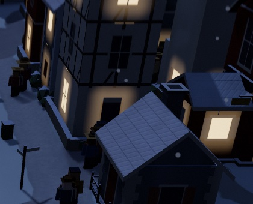 | 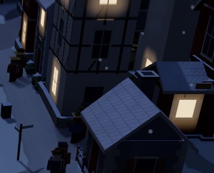 |

**Cause.** `src/render/kit/material.js` `facade()`. The front door takes the ground-floor window in the middle column. That code cleared the window's `glass` and `shutter` masks in the door's column, but not its `halo`, the warm spill drawn around lit windows at night. When the hidden window's per-window random said "lit", the door got a glowing rectangle around it.

**Fix.** `halo *= 1.0 - inCol` beside the other masks, one line. Lit windows keep their glow.

**Risk:** none. It only removes light that belonged to a window that is not drawn.

### 2. Gaps opening in tree crowns in the wind

**Cause.** In `src/render/trees.js` `VERTEX_BEGIN`, leaf flutter moved each foliage vertex along its shading `normal`. Crowns are flat-shaded clumps, so each corner is stored once per face. On purpose, their normals keep 30–40 % of each face's own normal (`finishGeometry`). Copies of one corner therefore moved in different directions and opened cracks that pulsed with the flutter.

**Fix.** Flutter now moves a vertex along the direction from its clump's centre (`position - aPivot`). Every copy of a corner shares that direction, because they share a position and a clump. The shading normals are unchanged, so the trees look the same; they just no longer split.

**Measured** (every corner shared by several faces, peak flutter, `buildGeometry` for each kind):

| kind | old max crack | new |
|---|---:|---:|
| round, near / far | 3.2 / 1.6 cm | 0 |
| tall | 3.6 / 1.9 cm | 0 |
| pine | 3.2 / 3.1 cm | 0 |
| bush | 2.1 / 1.8 cm | 0 |
| willow | 2.8 / 2.0 cm | 0 |

### 3. Faceted, banded valley edges

| before (seed 9, night, looking up the valley) | after |
|---|---|
| 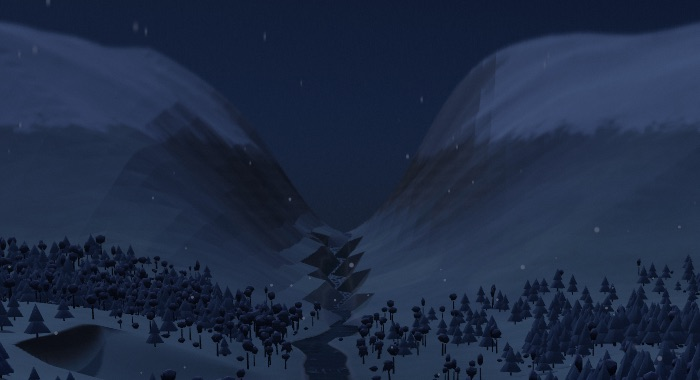 | 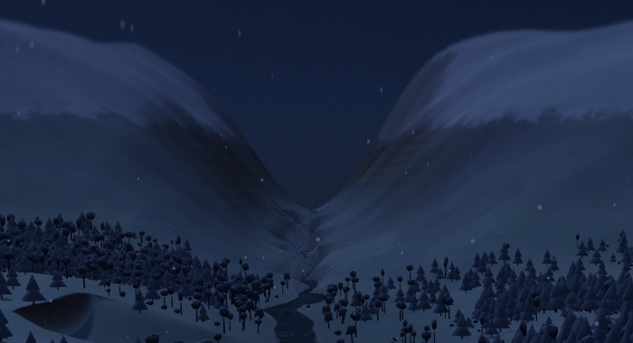 |

**Cause.** Beyond the 840 m ground texture, the hills are the "far ring" (`src/render/terrain.js` `buildRing`), an 8 m grid that was flat-shaded (`flatShading: true`, one normal per facet from `computeVertexNormals` on a non-indexed mesh). That is a problem twice over:
- Lighting changes at every facet edge.
- The material bands that depend on slope (`vUp`: rock, scree, snow) were chosen per facet too, so snow and rock switched on and off facet by facet. That is what drew the jagged bright triangles in the gorge and the straight seams on the slopes.

The rock strata were a hard `step()`, which added stair-like bands across the faces.

**Fix.**
- Smooth normals at the ring's nodes, from central differences of `heightAt`. That costs one extra `heightAt` per node inside the ground texture, about 11 k calls once at build. The rock, scree and snow bands now run smoothly across facets.
- The fragment shader blends 30 % of the facet normal back in (`RING_FACET_GLSL`), so the hills keep a hint of the cut-paper look.
- The strata are a soft triangle wave instead of a step.
- Triangle count and draw calls are unchanged.

**Risk:** low. This is the far ring only; the ground chunks the town stands on are untouched.

### 4. Pixelated gravel and blocky dirt edges

| before | after |
|---|---|
| 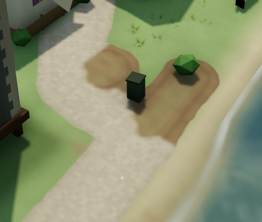 | 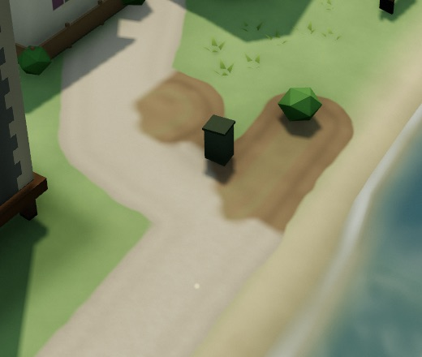 |

**Causes**, both in `src/render/roads.js` `ROAD_GLSL`:
- Gravel "grit" was `hash12(floor(world.xz * 6.0))`: a random brightness per 16 cm square. Up close that is literally a grid of pixels.
- Trampled dirt, and the snow that thins over it, come from the cell splat `tRoad`, one texel per 2 m cell. Plain bilinear filtering of that grid draws diamonds and stairs along their edges (visible in the owner's winter screenshot).

**Fixes.**
- Grit is two octaves of value noise, flattened to its average once it is under a few pixels.
- The dirt channel is read with a cubic B-spline (`textureBSpline`: four bilinear taps, GPU Gems 2 ch. 20), only where the old early-out lets the pixel through.
- Building footprints, wear and the path field keep their existing sampling.

**Risk:** low. The B-spline softens the dirt edge by a fraction of a cell, which the noisy threshold that follows already roughens.

### Cost and checks

- `node --test tests/render-*.test.js`: 65/65 pass.
- No console errors in the game (`?fixture=city&play=1`) or on the dev page.
- GPU A/B: see the table at the end.

---

## Proposals, ranked by value for effort

### P1. Ground surface detail on High: grass, dirt, sand, rock (value high, effort M, risk low)

> **Built** (2026-10-22), High only. See PERFORMANCE.md "Ground detail on High". Changes from the plan below:
> - Shingle and sand get no pebble noise: thresholded value noise read as glitchy blobs.
> - The lay uses a fixed prevailing direction, not `uWind`, which changes with the weather and would swing the pattern.
> - Two all-tier fixes for the hard sand/grass edge: a tapered beach channel, and the river strip reading it.
>
> Off (left) and on (right): 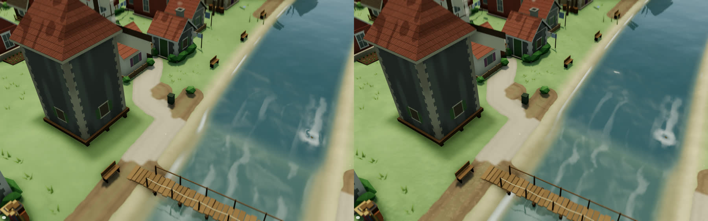 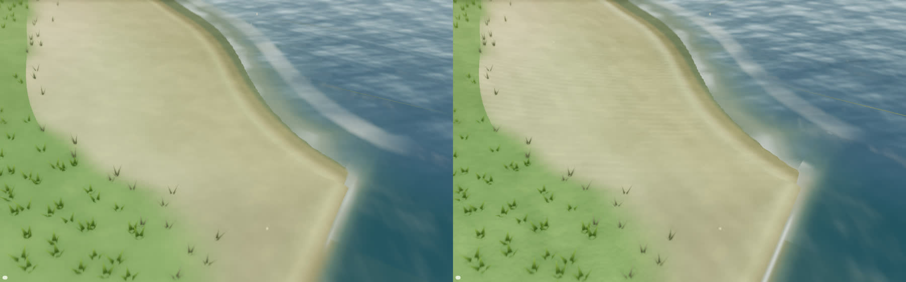 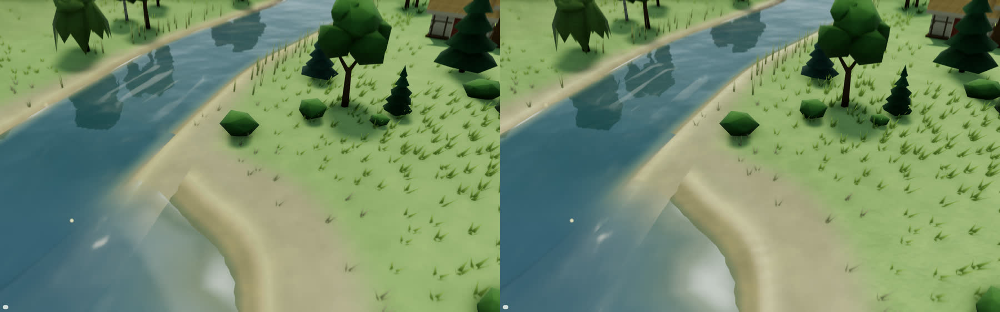 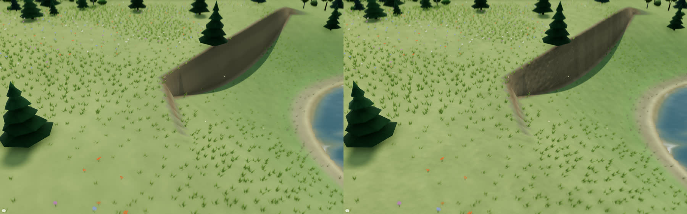
> The beach edge, before and after the taper: 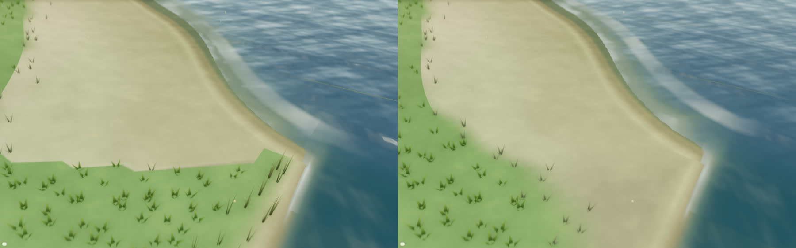

**Why.** Up close the ground is flat colour: the grass is one smooth green, sand and shingle are flat, and the rock faces are flat tone. Next to the detailed facades, roofs and paving, that reads as low resolution. The plumbing to fix it already exists, but only cobbles use it:
- `gBumpW` with `MICRO_NORMAL`, a world-space slope bump with no UVs or tangents (`shaderlib.js`, `docs/design/micro-detail.md`).
- `gSpecK` and `gSpecRough` for gloss (`SPEC_*`).
- Both sit behind the High tier's `microDetail` and `specular` flags.

**Plan**, all analytic, faded out by pixel footprint like `stoneSlope`, so far views pay nothing:
- **Value noise with derivatives.** Add `vnoised(p)`, which returns value and gradient (the standard quintic value-noise derivative), to `shaderlib.js NOISE`. One call gives both colour and slope.
- **Grass** (`terrain.js SHADE_FRAGMENT`, the `nearK` block that already computes `tuft`):
  - add `gBumpW.xz += grad(tuft) * 0.04` for a mown or tufted sward that catches low sun;
  - add a faint anisotropic "lay" (grass flattened along the wind direction `uWind`) as a low-frequency brightness ripple.
- **Dirt and trails** (`roadSurface`): pebble relief from a second octave inside `bareCover` and along `trail`, and a darker crack network from `abs(vnoise - 0.5)` ridges.
- **Sand** (`terrainAlbedo` beach block and river banks):
  - wind ripples: `sin(dot(p.xz, dir) * 9 + noise * 4)`, used as both height and slope, faded out under 6 px per ripple;
  - a wet band with `gSpecK` about 0.5 and roughness 0.3 just above the waterline. It already has the darker wet colour; the sheen sells it.
- **Rock faces** (`rock > 0`): a triplanar-free trick. Bump with `vnoised` on `p.xz` plus `p.y` (two planes are enough on a heightfield) at 0.6 and 1.7 m.

**Cost estimate:** 4–8 extra `vnoise` calls on near ground pixels only. By analogy with the cobble relief (+0.03–0.06 ms per pass, PERFORMANCE.md) expect about 0.1–0.2 ms on an M5 Pro at 1440p. Low and Medium compile what they do today.

**Effort:** 1–2 days, including an A/B with `scripts/micro-detail-ab.js --target=terrain`.

### P2. Windmills by the river: a renderer/sim mismatch (value high, effort S for the visual fix, M for the real one)

**Finding.** The sim has no windmill.
- Its `mill` is `variants: ['water-mill','steam-mill']` (`src/sim/buildings.js:34`), a member of `WATER_TYPES`, so it must touch the river (`src/sim/sites.js:40, :868`).
- The renderer then draws every pre-industrial mill as a tower windmill with sails (`src/render/kit/compose.js:514`, `case 'mill': if (era < 3)`).
- So the "windmills" are water mills in disguise. That is why they stand on the bank wherever a mill went, with no regard for wind.

**Options.**
- **(a) Small, renderer only.** Draw the era-0..2 mill as what the sim means: a mill house with an undershot wheel on the river side (the lot is guaranteed to touch the river), with the wheel turning on `uDecoTime`. Half a day. No sim, save or test changes.
- **(b) The real thing (sim).**
  - Add a `windmill` type or variant, kept out of `WATER_TYPES`.
  - Site it with a new analytic `windExposureAt(x, z)`: height and prominence, plus fetch over open water (`bankDistance`), minus shelter from `woodField` (`src/woodland.js`).
  - Score it in `archetypeBias` or `hillBias` (`sites.js:847/:111`).
  - Let compose.js branch on the variant rather than the era.
  - Breaks the `tests/sim-world.test.js:178` test "mills need the river".
  - Touches enterprise labour (`src/sim/enterprises.js:319`) and `millOutput` (`src/sim/economy.js:423`).
  - About 1–2 days.

  This is simulation work, so it should be coordinated with the session working on sim data locality.

**Recommendation:** (a) now. (b) later, together with P3, since both are "siting reads the land".

### P3. Hillside building standards: foundations that cost money (value medium-high, effort M, sim)

**Finding.** Steepness is only a hard gate, and nothing charges for it.
- **Siting** (`src/sim/sites.js` `scoreLot`, :859–917) rejects a lot whose `lotSlope` exceeds `maxSlopeFor(type, era)`:
  - 0.2 for most types, 0.4 from era 2;
  - farms 0.08;
  - pits and quarries 0.6.

  Below the gate there is a soft `-0.6·min(1, slope/0.25)`. So from era 2 a house will sit on a 0.4 slope for nearly the same score as on flat ground.
- **Cost:** construction cost is coin only (`TYPES[type].cost × ERA_COST`, `buildings.js:81`), with path and land-sale surcharges (`placeBuilding`, :296–300). Nothing charges for the plinth. `foundationY` and `foundationDrop` are already computed (`setFoundation`, :952–1001), and the renderer already draws plinths, piles and skirts from them (`compose.js:92–103, :211–224`).

**Proposal.**
1. **Cost.** In `placeBuilding`, add `foundationSurcharge = k · foundationDrop · footprintCells · eraFactor` beside the path surcharge. `setFoundation` already ran at :291, so `foundationDrop` is known. Store it on the project for the UI ("raised foundation +N").
2. **Siting.** In `scoreLot`, replace the hard slope reject with an economic one:
   - allow a steep lot only when `landValueNorm × footprint` covers the foundation cost;
   - keep a hard ceiling around 0.6–0.7 for safety;
   - give the score a term `-w · foundationCost / (landValue · LV_MAX)`.

   Land value already includes `+6 × prominence` (the view), so hillsides near a crowded centre will still be built when that pays: terraces, stepped streets. Cheap flat land further out wins otherwise, which pushes the town onto the flat as asked.
3. **Rendering (optional, later).** On drops over about 2 m, draw a retaining wall or stepped terrace and an outside stair from the street to the door, instead of a tall plain plinth. `compose.js` already knows the drop and the door side.

**Tests this would move:**
- `tests/sim-world.test.js:730` (every lot within `maxSlopeFor`);
- the "hill town" in `tests/foundations.test.js:98`;
- possibly the starvation check in `tests/sim-growth.test.js:30`.

Determinism tests compare two runs, so they stay valid. The cached fixtures change only if regenerated. **Effort:** 1–2 days of sim work plus balance passes.

### P4. Perceived sharpness: tilt-shift and dawn mist (value medium, effort S, risk none)

**Tilt-shift.** The finishing pass blurs the top and bottom of the frame up to `2.5 × DPR` pixels (`src/render/post.js:87, :138`). It is the toy-town look, but it also makes the foreground and background ground (the bottom of every overview shot above) look low resolution, which is part of what reads as "pixelated" ground. Two options:
- halve `uMaxBlur` when the camera is close (it is a model look that matters most in overviews);
- or expose it as a "Miniature focus" setting.

**Dawn mist.** On High, the dawn mist at the start of each year can grey out most of the city in the overview. I saw it in the game at year 92 spring, but did not measure it. Worth capping its opacity over built-up cells, or by camera distance (`src/render/mist.js`).

### P5. Night windows that read as rooms, not lightboxes (value medium, effort S)

At night every lit window is a flat, near-white rectangle with a soft square halo (`material.js`: `emissive = fz.x * lit + halo * lit * 0.12`, and the `halo` falloff is linear to 0.9 m, which shows an edge). Cheap upgrades in the same function:
- **Halo falloff:** square it (`halo * halo`) so the spill fades without a visible rim.
- **Room interiors:** a vertical gradient (brighter at the top, a dark sill band), a per-window warmth from the existing hash (candle orange against lamp yellow), and in a third of windows a curtain edge or a dark silhouette strip. These are all masks on `glass` with no texture.
- **Late night:** windows go dark progressively through the night beat (`uNight` against a per-window threshold), so a sleeping town is darker than a dusk one.

Half a day; no extra draw calls.

### P6. Sand, rock and tree polish beyond P1 (value medium, effort S–M)

- **Trees:** the crowns already have wind sway, flutter, light through the leaves, and per-seed summer greens with a staggered autumn turn (`trees.js:724`). The sway's phase already drifts with position (`trees.js:702`), but its strength is the same everywhere. The cheap missing piece is gusts: scale it by a slow world-space noise that travels with `uWind`, so patches of stronger movement roll across a wood.
- **Rock:** there is no boulder or outcrop prop in the renderer (grep finds none). Rock exists only as the terrain's steep-slope colour, so the P1 rock bump is the whole of the rock work. A few instanced outcrops where `rock > 0.5` on the ground texture would add scale to hillsides. That is a later, separate piece.

### P7. Lived-in density without new systems (value medium, effort S each)

These reuse existing instancing (decor, props, ground cover). Each is a few hours. Already present (I checked): woodpiles, washing lines, vegetable plots, barrels and crates, handcarts, hay, street lamps with ground light pools, chimney smoke, cattle, boats and birds. Missing or thin:
- **Field boundaries:** hedgerows or dry-stone walls along farm edges and lanes. One instanced mesh per kind, placed from lot edges. Fields are a large share of the overview, and boundaries are what make farmland read as worked.
- **Door furniture:** a potted plant or boot scraper at house doors, and a lantern over doors that lights at night. decor.js already places barrels, crates and benches by the doors of trading and gathering lots (:674, :1106), so the placement exists; houses are the gap.
- **Window boxes and climbers:** a window-box strip under some upper windows, and ivy on old walls from the existing `age` and `condition` masks in `material.js`. Shader only, no geometry.
- **Worn thresholds:** a darker trodden patch in front of every door and gate, written into the B channel of `tRoad` the same way trampling is.
- **Street trees** on avenue-tier roads in the city era.
- **Light from windows on the ground:** a soft warm patch on the ground in front of lit ground-floor windows. Use the existing light-pool decal in props.js, driven by the same per-window lit hash.

---

## Not covered

- Phone widths, light and dark UI themes, and labels overlapping the scene were not reviewed. The owner asked to focus on the scene. The one game screenshot at 800×600 showed no overlap.
- No CPU, per-frame allocation or long-frame audit in this pass. PERFORMANCE.md "Remaining hotspots" is still the list there.

## GPU A/B

`scripts/fidelity-shots.js`, High, DPR 1.25, 1440×900, M5 Pro, load average 2.7–6, `914f6aa` against this branch.

**Round 1.** All eight views, two alternating pairs, mean of the two medians, before the dirt B-spline was limited to trampled pixels:

| view | before | after | Δ |
|---|---:|---:|---:|
| town-summer | 5.01 | 4.92 | −0.09 |
| town-close | 4.72 | 5.01 | +0.29 |
| town-rain | 5.05 | 5.41 | +0.36 |
| town-dawn | 5.49 | 5.64 | +0.15 |
| forest-edge | 5.06 | 5.52 | +0.46 |
| city-autumn | 6.32 | 6.26 | −0.06 |
| city-close | 5.10 | 5.14 | +0.04 |
| city-winter-dusk | 5.75 | 5.85 | +0.10 |

**Round 2.** After limiting the B-spline to pixels with trampling (`if (dirt > 0.002)`): the four town views, three alternating pairs, median of three:

| view | before | after | Δ |
|---|---:|---:|---:|
| town-summer | 5.18 | 5.15 | −0.03 |
| town-close | 4.97 | 5.14 | +0.17 |
| town-rain | 5.49 | 5.59 | +0.10 |
| forest-edge | 5.03 | 5.32 | +0.29 |

**Reading.** Run-to-run spread is ±0.3–0.5 ms (forest-edge base: 5.02, 5.03, 5.92), so most deltas are inside the noise. The overall cost is about +0.1 ms, or 2 %. The one consistent rise is forest-edge, about +0.3 ms. That is plausibly the flutter's per-vertex normalise over a few million foliage vertices (main and shadow passes). If it matters, bake the unit clump direction into a vertex attribute at build time (one vec3 per foliage vertex).
