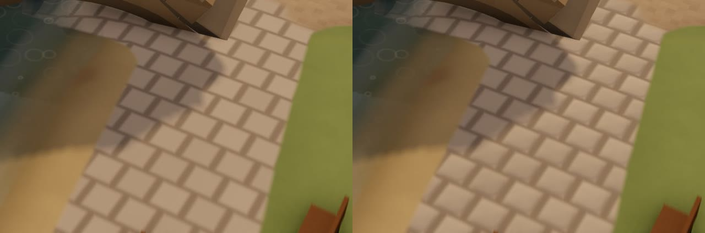
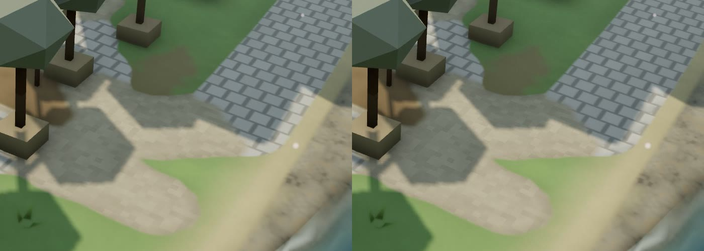
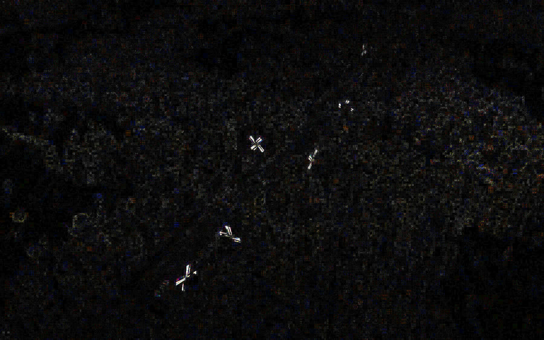
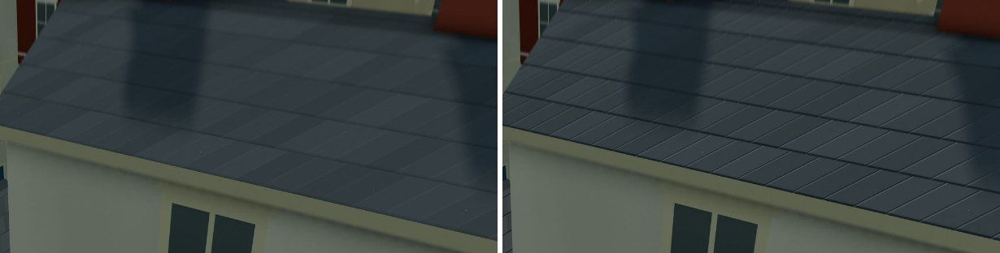
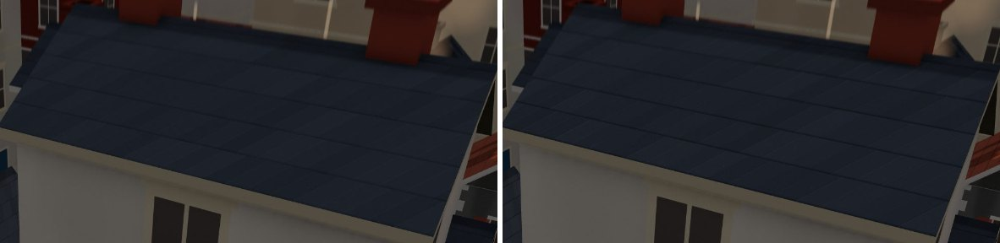
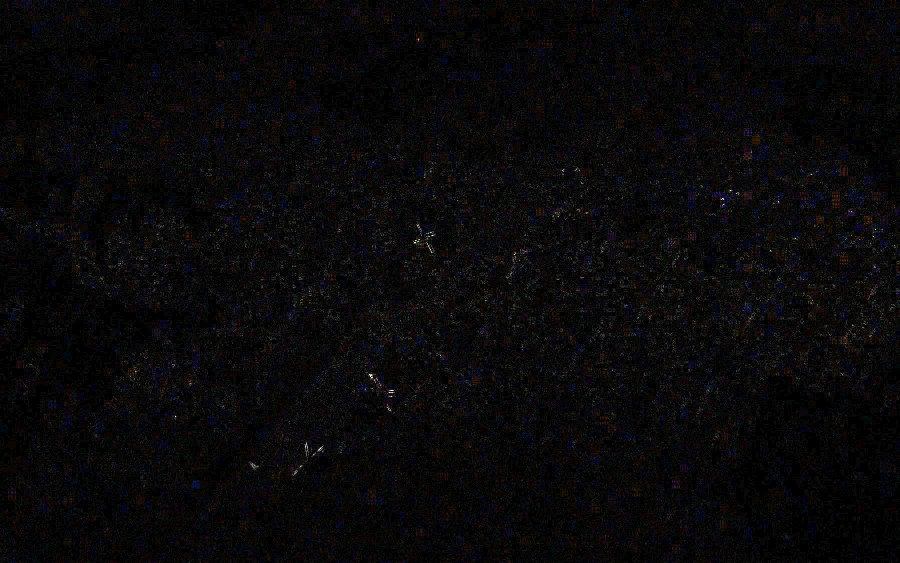

# Surface micro-detail without polygons (design)

> **Prototype built** (2026-10-21): stone relief on the road splat's cobbles and setts,
> High tier only (`microDetail` in `src/render/quality.js`). Code: `stoneSlope` in
> `src/render/roads.js`, `MICRO_HEAD` / `MICRO_NORMAL` in `src/render/shaderlib.js`, the
> `MICRO_DETAIL` define in `src/render/terrain.js`. Results in §4.
>
> **Phase 2 built** (2026-10-21): lapped courses on tile, slate and shingle roofs, High
> only. Code: the roof branch of `src/render/kit/material.js`, `MICRO_ARB` in
> `shaderlib.js`, `setKitMicroDetail` called from `buildings.js` `applyQuality`. Results
> in §4b.

**Recommendation.** Use **procedural normals from the analytic height of the patterns
we already draw**. Each pattern function (cobbles, setts, roof courses, brick and quoin
blocks) gets a sibling that returns the slope of the same shape. The shading normal is
tilted by that slope with Mikkelsen's surface-gradient formula, so no tangents, UVs or
textures are needed. Fade it by pixel footprint, skip it past a few pixels per stone,
and keep it High-only. Do **not** adopt parallax, POM, relief or cone-step mapping: they
need tangent-space UVs we do not have, cost 8–32 height evaluations per pixel, and their
gain (stones that hide each other at grazing angles) hardly shows at our 40–200 m camera.

The prototype (stone relief on cobbles and setts, §4) costs **+0.02 to +0.06 ms of
GPU per terrain pass** on an M5 Pro, measured as an upper bound with the terrain drawn
alone. In the whole frame that is lost in the noise. Low and Medium compile exactly the
shader they did before. Close up, at low sun, the paving reads as laid stone instead of
paint. **Keep it**, and roll the same method out to roof courses next (§5).

## 1. What the renderer gives us to work with

- **Lighting is Lambert everywhere.** `MeshLambertMaterial`, patched by `patchMaterial`
  (`shaderlib.js`). In r180 three's Lambert shades per fragment
  (`lights_lambert_fragment` reads `normal`), so a perturbed `normal` changes the result. It has a hemisphere light (sky `#dcefff`, ground
  `#6e7d4a`, 1.4) and one sun (2.8, PCF shadows) (`lights.js`). There is **no specular
  term**, and so no specular aliasing (the classic reason for Toksvig or LEAN). A tilted
  normal changes only `N·L` for the sun and the sky/ground mix of the hemisphere.
  Shadows come from the shadow map in the vertex stage, so bumps never self-shadow.
- **What a normal tilt buys depends on the sun.** At noon (sun at about 60°) a 15° tilt
  changes `N·L` by 5–15 %. At dawn, dusk and in winter (sun at 10–25°) the same tilt
  changes it by 50–100 %: the slope facing the sun is twice as bright as the one turned
  away. The seasonal cycle spends a lot of time at low sun, so relief reads well.
- **The far ring is `flatShading`**, and so is nothing else we would bump. The ground
  chunks have smooth normals from the ground texture. Kit pieces are boxes with face
  normals.
- **No textures, tangents or UVs on the surfaces that matter.** The terrain fragment
  knows its world position. Kit fragments know `vLocal` (metres in the instance's
  frame), `vObjN` (the object-space face normal), the part id and the style params.
  Facade, timber, quoin, roof-course, thatch and cobble detail is all analytic.
- **Detail already fades by footprint.** Facades fade below about 4 px per metre
  (`sharp`), roof courses below 3–8 px per course (`roofSharp`), road edges are
  anti-aliased over about one pixel (`px`). Micro-detail can reuse the same measures.
- **Cost budget.** High runs at DPR 1.75 with MSAA and an SSAO + tilt-shift post pass.
  `scripts/fidelity-shots.js` measures 4–7 ms of GPU per frame on an M5 Pro. Low must
  not change at all, and phones run Medium or Low.

## 2. The techniques, against this pipeline

Camera ranges: default 40–200 m, closest 14 m (`controls.minDistance`), grazing views
at the 0.44π polar limit (about 11° above the horizon).

| Technique | Cost per fragment | Needs | Visual gain here | Fits our pipeline? |
|---|---|---|---|---|
| **Analytic procedural normals** (slope of the pattern's own height) | ~20–40 ALU, no fetches; one extra hash | position only | Stones, courses and blocks catch the sun on one side; strong at low sun, visible to ~120 m | **Yes.** Same functions we already evaluate; exact; no derivatives, so it works in our non-uniform branches; band-limit by widening edges with `px`. |
| Finite differences of the pattern (3 evaluations) | 2× the pattern's cost | position only | Same as analytic | Yes, as a fallback for patterns whose derivative is messy (noise fBm). Use analytic where it is easy. |
| Screen-space derivative bump (`dFdx(h)`, Mikkelsen 2010; three's `bumpMap` path) | ~10 ALU on top of `h` | position, `h` | Same idea, but per 2×2 quad: blocky edges, and the gradient is undefined inside non-uniform control flow | Partly. Our pattern code sits in branches (`roadSurface` returns early). Fine for one-off soft noise outside branches, not for stones. |
| Surface gradient framework (Mikkelsen 2020) | ~6 ALU to apply | the normal | The *formula* we use to apply any of the above | **Yes, as the glue**: project a 3D height gradient onto the surface, `n' = normalize(n − (g − (g·n) n))`. No tangents. |
| Tangent-space normal maps | 1 fetch + TBN | UVs and tangents | Baked detail | No. We have neither, and the art is analytic. |
| Triplanar normal maps (Golus 2017) | 3 fetches + blend | position, a texture | Baked detail on any shape | Only if we bake detail textures (bark, thatch straw). Not needed for stones. Keep it in reserve for organic surfaces (§5, phase 4). |
| Parallax offset (Kaneko 2001; Welsh 2004 offset limiting) | 1–2 height evals | tangent-space view vector | Stones shift a little with view; swims at grazing angles | No. Needs a tangent frame; the gain is small on 2–4 cm relief seen from 40 m+. |
| Steep parallax / POM (Tatarchuk 2006) | 8–32 height evals + refine | tangent frame, a height field | Occlusion between stones at grazing angles; silhouettes stay flat | No. 10–30× the cost of the stone function, on full-screen terrain. Flat silhouettes at the kerb. Steps visible at grazing views unless steps grow. |
| Relief / relaxed cone stepping (Policarpo & Oliveira, GPU Gems 3 ch. 18) | 10–20 steps, needs a cone map | precomputed cone texture | Correct self-occlusion | No. Needs a preprocessed texture per pattern; ours are analytic and per-instance. |
| Normal filtering (Toksvig 2005, LEAN 2010) | 1–3 ALU | a normal-length or variance term | Kills sparkle in specular | Not needed: Lambert has no lobe to widen. The diffuse equivalent is to **fade the slope** with footprint, which we do. |
| Cavity / curvature darkening | free (already in albedo) | the pattern | Joints darker | **Yes, already there** (dark joints, course lines). Keep: it is what reads at 150 m+ after relief fades. |
| Baked AO strips | free | per-part AO | Contact darkening | Already in the kit (`aPartAO`) and the ground AO field. |
| Sun-facing rim shading | 2–3 ALU | the pattern, `uSunDir` | Lit edges facing the sun | Partly. A cheap stand-in for relief on Medium (§5), since it needs no normal. |

**Why not POM, plainly.** Our relief is shallow (2–4 cm on stones 0.4–0.55 m wide). At
a 35° view, the top of a stone 3 cm high moves by `h·cos θ` ≈ 2.5 cm across the view
against its joint. On High at DPR 1.75 that is about 1.3 px at 40 m and half a pixel at
100 m. Only at the 14 m minimum does it reach 4 px. What reads is shading, not parallax. POM would multiply the road splat's cost
by 10× or more for a gain the camera cannot show.

**Aliasing.** There is no specular, so the risk is diffuse shimmer when a slope changes
inside a pixel. Two measures handle it: the chamfer of each stone is never narrower than
1.5 pixels (`e1` in `stoneSlope`, which widens with `px`). This band-limits the relief
the way `boxMask` band-limits the facade. Then the whole slope fades out as the pixel
footprint grows from 6 to 12 cm. MSAA does not help shading aliasing; this does.

## 3. Which surfaces, which technique

| Surface | Where | Pattern today | Relief | Priority |
|---|---|---|---|---|
| Cobbles (tier 4) and setts (tier 5) | `ROAD_GLSL` | `cobbles()` | Domed / chamfered stones, per-stone tilt | **1 (built)** |
| Roof tiles, slates, shingles | `material.js`, roof branch | course lines + staggered joints | Sawtooth step per course (each course laps the one below), joints as shallow grooves | **2** |
| Quoins, string courses, plinths | walls branch | colour bands | Blocks proud of the wall: chamfered edges | 3 |
| Timber framing | walls branch | dark bands | Timbers proud of the render by 2–3 cm | 3 |
| Weatherboard | walls branch | lines every 0.3 m | Sawtooth, like roof courses | 3 |
| Thatch | roof branch | streaks + courses | Soft ridges along the streaks (noise slope by finite difference) | 4 |
| Flagstones, kerbs | `ROAD_GLSL` | kerb band | Kerb as a raised edge (needs the strip SDF's slope) | 4 |
| Bark | trees | none | Triplanar or a vertical ridge noise | later |

## 4. The prototype: stone relief on the road splat

**What it does.** `stoneSlope(world, scale, amp, edge, round, px)` mirrors `cobbles()`:
the same 1.8 / m grid, the same running-bond offset, the same 1.1 stretch. It returns
the world-space slope `(dH/dx, dH/dz)` of a stone shaped as:

- a rounded square (a superellipse with n = 4, so the slope has no crease along the
  diagonals, which `max()` would give);
- a smoothstep chamfer from the joint up to the top, at least 1.5 px wide;
- a crown (`round` = 1 for domed cobbles, 0.25 for flatter setts);
- a per-stone tilt of up to ±3.4° from a second hash, as if each stone were bedded by hand.

Cobbles are 3.5 cm high, setts 2 cm. `roadSurface` weights the slope by paving cover,
cobble/sett blend and the kerb, and by the footprint fade, then adds it to `gBumpW`.
After `normal_fragment_maps`, `MICRO_NORMAL` turns it into view space and applies the
surface gradient. The whole block is skipped where the footprint fade is zero, which is
most of a far view.

**Gating.** `microDetail: true` on High only. The terrain material compiles it in through
the `MICRO_DETAIL` define (with `CLOUD_SHADOW`, in `applyQuality`). Without the define,
Low and Medium compile exactly the shader they compiled before. The far ring never gets
it. For A/B, the dev page takes `&micro=0|1` (`tierPatch` in `createWorld`), and
`scripts/fidelity-shots.js --extra="micro=0"` appends it to every view.

### Results

**Shader errors: none** on Low, Medium and High (`fidelity-shots.js --query=…` on each
tier, plus Medium with `&micro=1` forced on). `npm test`: 415 of 415 pass.

**Look.** Left is off, right is on. The cobbled approach to the bridge (city fixture,
20 m, High, `yearT=0.66`):

A clear morning (`yearT=0.1&weather=clear`, 22 m). The lane at top right gets a lit
edge and a shaded edge on every stone. The square in the shade of the trees changes
only through the hemisphere term:

At the default overview (`city-autumn`), the relief is fully faded out. The difference
image between off and on (×8) shows only the windmill sails, which turn between shots,
and JPEG noise:

How far it reaches: the slope fades out as the pixel footprint grows from 6 to 12 cm.
At DPR 1.25 and a 30° view that is about 60–80 m. At High's own DPR 1.75 it is about
85–110 m. So it shows at the near end of the default 40–200 m range, and fully when
the player zooms in. It cannot shimmer further out, because there it is not computed.

**Cost.** Apple M5 Pro, Chrome headless with ANGLE Metal, DPR 1.25, 1440×900. The
machine was shared with other sessions running GPU work (load average 16–22). Whole-
frame GPU time moved by ±1–2 ms between blocks of identical frames, so it cannot
resolve this change. `scripts/micro-detail-ab.js` (new) loads each view once, flips
the terrain's `MICRO_DETAIL` between interleaved blocks and reports medians.
"Terrain alone" hides everything but the terrain and the lights, and times 10 renders
straight to the canvas per query. There are no occluders and no post pass, so every
terrain pixel is shaded. This is an upper bound on the relief's cost.

| view (High) | terrain alone, off → on | Δ median (min … max of 24 pairs) | whole frame, off → on | Δ median |
|---|---:|---:|---:|---:|
| bridge (20 m) | 2.343 → 2.383 ms | +0.061 (−0.18 … +0.95) | 4.68 → 5.07 ms | +0.09 |
| street (40 m) | 2.676 → 2.687 ms | +0.038 (−0.17 … +1.07) | 5.46 → 5.45 ms | −0.00 |
| square, dawn (25 m) | 2.276 → 2.305 ms | +0.037 (−0.01 … +0.84) | 5.79 → 6.16 ms | +0.36 |
| paving fills the screen (16 m, from above) | 1.931 → 1.975 ms | +0.046 (+0.02 … +0.08) | 5.90 → 5.55 ms | +0.21 |
| city-close (60 m) | 2.715 → 2.749 ms | +0.017 (−0.04 … +1.02) | 5.67 → 6.02 ms | +0.45 |
| city-autumn (overview) | 2.801 → 2.882 ms | +0.051 (−0.08 … +1.06) | 6.19 → 6.12 ms | +0.20 |
| town-close (55 m) | 1.597 → 1.623 ms | +0.027 (−0.01 … +0.17) | 6.29 → 5.40 ms | −0.36 |

The terrain-alone numbers agree across views: **+0.02 to +0.06 ms, 1–2.5 % of the
terrain pass**, with the screen full of paving at the top of that range. Whole-frame
medians scatter both ways by far more than that, so the frame-level cost is too small
to measure here. Under 0.1 ms is the honest bound.

**`fidelity-shots.js --noshot`, baseline `a5347fc` against this branch** (High, so
relief on). Three alternating runs each, under the same load. Median GPU ms per frame
(the runs are in brackets):

| view | before | after |
|---|---:|---:|
| town-summer | 4.34 (4.69 / 4.33 / 4.34) | 4.29 (5.03 / 4.27 / 4.29) |
| town-close | 5.49 (5.49 / 5.79 / 4.37) | 4.95 (5.39 / 4.88 / 4.95) |
| town-rain | 5.46 (5.46 / 5.76 / 4.43) | 5.68 (5.68 / 6.24 / 4.42) |
| town-dawn | 4.60 (5.49 / 4.60 / 4.57) | 5.43 (5.43 / 4.69 / 6.64) |
| forest-edge | 4.94 (5.52 / 4.94 / 4.11) | 5.01 (4.85 / 5.01 / 5.09) |
| city-autumn | 5.07 (5.48 / 4.82 / 5.07) | 4.90 (4.71 / 4.90 / 4.95) |
| city-close | 5.10 (5.16 / 5.10 / 4.30) | 4.67 (4.67 / 4.27 / 5.53) |
| city-winter-dusk | 5.37 (5.85 / 5.37 / 4.78) | 5.23 (5.23 / 4.97 / 5.52) |
| **sum of medians** | **40.4** | **40.2** |

Before and after are level. Single runs of one view spread by up to 2 ms, so this table
can only say the change is well under that. The terrain-alone A/B above is the real
measurement. One caveat about the harness, which predates this change: the same view
draws about 60 calls in some runs and about 100 in others, even after an 8 s wait. So
it samples two different scene states (see the `calls` column in
`*-stats.json`). It should wait for a steady draw count, as `micro-detail-ab.js` does.

**Verdict: worth keeping.** On High it costs about 0.05 ms at most. It changes nothing
past about 100 m, and nothing at all on Low and Medium. Close up it turns flat paint
into laid stone, most of all at low sun.

## 4b. Phase 2: roof courses

**What it does.** In the roof branch (`rk < 3.5`), the height above the roof plane is
`H = lap · (1 − t) · smoothstep(0, e, t)` with `t = fract(cy)`: it falls from the butt of
each course to its head, and steps back up at the next course line. The step `e` is
6 % of a course, and never narrower than 1.5 px. The staggered joints (`jx`) are grooves
half a lap deep, with walls at least 1.5 px wide. Laps: 1.5 cm for tile, 0.8 cm for
slate and shingle. The slope fades with `roofSharp · facadeOn`, so it is skipped past
3–8 px per course.

**How the normal tilts.** The gradient is analytic in `vLocal`. At the top of
`FRAGMENT_COLOR`, where control flow is uniform, the shader takes `dFdx`/`dFdy` of
`vLocal` and of the view position. After `normal_fragment_maps` it chain-rules the
gradient into screen space (`dH/dx = ∇H · dFdx(vLocal)`) and applies Mikkelsen's 2010
formula (`microPerturb`, three's `perturbNormalArb` with unnormalised derivatives, so the
slope is in metres). No new attributes or varyings are needed.

**Gating.** `setKitMicroDetail` adds `MICRO_DETAIL` to every kit material on High (and
under `&micro=1`). Without it, the preprocessed shader is exactly what it was before,
and the program cache key is unchanged. `micro-detail-ab.js --target=kit` flips it in
place, over a set of roof views.

**Shader errors: none** on Low, Medium, High, and Medium with `&micro=1`. `npm test`:
415 of 415 pass.

**Look.** Left is off, right is on (High, `&micro=0|1`; this flag also turns the paving
relief off). A clear morning on slate (`yearT=0.1&weather=clear`, 28 m): each course
gets a lit butt edge, and the joints read as cut slates.

At dawn (`yearT=0.02`, 30 m) the course steps show, more softly:

At the default overview (`city-autumn`), the difference (×8) is only the windmill sails
and JPEG noise. A course there is under 3 px, so `roofSharp` has faded the relief out.
That is correct: the profile is periodic, so below a course per few pixels its slope
averages to zero. **The roof relief therefore helps when zoomed in, not at the default
overview**, which corrects the expectation in §5.

One artefact: very close to a roof (a tall house at `dist=20`, a few metres from the
camera), a single joint groove spans many pixels and reads as a pale stripe. That is
closer than normal play reaches.

**Cost.** `micro-detail-ab.js --target=kit` (8 blocks), M5 Pro, DPR 1.25. The machine
was even busier than in §4 (load average 19–31). "Buildings alone" hides all but the
buildings and the lights, with no post pass: an upper bound. One run only; it was not
repeated.

| view (High) | buildings alone, off → on | Δ median (min … max) | whole frame Δ median |
|---|---:|---:|---:|
| roofs, 20 m | 0.960 → 1.008 ms | +0.055 (+0.01 … +0.32) | +0.65 |
| roofs, 40 m | 1.015 → 1.055 ms | +0.042 (−0.04 … +0.33) | +0.18 |
| roofs, dawn (30 m) | 0.996 → 1.025 ms | +0.030 (−0.40 … +0.46) | +0.71 |
| roofs fill the screen (18 m, from above) | 0.997 → 0.992 ms | −0.009 (−0.44 … +0.67) | +1.11 |
| city-close (60 m) | 1.077 → 1.110 ms | +0.034 (−0.16 … +0.46) | −0.28 |
| city-autumn (overview) | 1.096 → 1.133 ms | +0.038 (−0.66 … +0.70) | +0.58 |
| town-close (55 m) | 0.797 → 0.926 ms | +0.105 (−0.78 … +0.49) | −0.10 |

**About +0.03 to +0.06 ms** per buildings pass in most views; town-close's +0.1 sits
inside its own spread. Whole-frame deltas scatter by ±1 ms both ways under this load
and cannot resolve it. Even the overview, where the relief is faded out, pays about
the same: the derivatives and the normal hook run on every kit fragment. Under 0.1 ms
is the honest bound. **Keep it.**

## 5. Rollout plan

Every phase lands on its own, High first, and each one is measured with
`micro-detail-ab.js` (extend its `setMicro` to the kit material's define).

1. **Paving (done).** Cobbles and setts. Tuning knobs: amplitudes (3.5 / 2 cm),
   per-stone tilt (±0.06), footprint fade (6–12 cm). Flagstone squares later reuse
   `stoneSlope` with a larger grid and `round = 0`.
2. **Roof courses (done, §4b)** (`material.js`, the `rk < 3.5` branch). Each course laps the one
   below, so a tile's height above the roof plane falls from its butt to its head:
   `H = lap · (1 − fract(cy))`, with a step at each course line, plus shallow grooves at
   the staggered joints (`jx`). Laps: 1.5 cm for tile, 0.8 cm for slate and shingle.
   This is the biggest gain at the default camera: roofs fill most of a city view and
   face the sun. It is also the cheapest, a few ALU on top of the course code. Fade it
   with the existing `roofSharp`.
   *How to tilt the normal on the kit.* The slope is analytic in `vLocal` (metres in the
   instance frame, yaw-only rotation). Take `dFdx(vLocal)`, `dFdy(vLocal)` and the
   same for `vViewPosition` once, at the top of `FRAGMENT_COLOR`, where control flow
   is uniform. Then `dH/dscreen = dot(∇H, dFdx(vLocal))` is exact per pixel, and
   three's `perturbNormalArb` (Mikkelsen 2010) turns it into the normal. This needs no
   new attributes or varyings. Another route is a `vec2 vYaw` varying and the same
   `MICRO_NORMAL` as the terrain.
3. **Wall relief** (`material.js`, walls branch). Quoins and string courses proud of
   the wall by 2–3 cm with a chamfer. Timber framing proud of the render. Weatherboard
   as a sawtooth every 0.3 m. Plinth as a step. All from masks the shader already
   computes. Fade with the existing `sharp`. Window reveals (a dark inset) are colour
   work, not relief, and already read.
4. **Organic surfaces.** Thatch: the slope of the streak noise along the combing, by
   finite differences of `vnoise` or Quilez's analytic value-noise derivatives. Kerbs
   as a raised edge (the slope of the strip's signed distance). Bark, if trees ever get
   close-ups: a vertical ridge noise. A baked triplanar normal map is the fallback if
   procedural noise looks too clean.
5. **Medium tier.** Measure phases 1–2 on a phone-class GPU (an A-series iPhone in
   Safari, and a mid-range Adreno) before turning it on for Medium. If it is too dear
   there, the cheap stand-in is a sun-facing rim: brighten the stone edge that faces
   `uSunDir` and darken the other. That is albedo work, with no normal and no lighting
   change. Low stays exactly as it is.

**Not planned:** parallax offset, POM, relief and cone-step mapping (§2). Revisit only
if the camera ever gets a street-level mode, below about 5 m, with grazing views of
deep relief such as thatch eaves or dry-stone walls.

## Sources

- M. S. Mikkelsen, “Surface Gradient–Based Bump Mapping Framework”, JCGT 9(3), 2020. <https://jcgt.org/published/0009/03/04/>
- M. S. Mikkelsen, “Bump Mapping Unparametrized Surfaces on the GPU”, JGT 15(1), 2010. <https://doi.org/10.1080/2151237X.2010.10390651>. This is what three's `bumpmap_pars_fragment` (`perturbNormalArb`) implements in r180.
- N. Tatarchuk, “Practical Parallax Occlusion Mapping with Approximate Soft Shadows for Detailed Surface Rendering”, SIGGRAPH 2006 course. <https://advances.realtimerendering.com/s2006/Chapter5-Parallax_Occlusion_Mapping_for_detailed_surface_rendering.pdf>
- F. Policarpo, M. M. Oliveira, “Relaxed Cone Stepping for Relief Mapping”, GPU Gems 3, ch. 18. <https://developer.nvidia.com/gpugems/gpugems3/part-iii-rendering/chapter-18-relaxed-cone-stepping-relief-mapping>
- M. Toksvig, “Mipmapping Normal Maps”, JGT 10(3), 2005. <https://developer.download.nvidia.com/whitepapers/2006/Mipmapping_Normal_Maps.pdf>
- M. Olano, D. Baker, “LEAN Mapping”, I3D 2010. <https://www.cse.chalmers.se/edu/year/2011/course/TDA361/Advanced%20Computer%20Graphics/LEANMapping.pdf>
- B. Golus, “Normal Mapping for a Triplanar Shader”, 2017. <https://bgolus.medium.com/normal-mapping-for-a-triplanar-shader-10bf39dca05a>
- I. Quilez, “Value noise derivatives”. <https://iquilezles.org/articles/morenoise>
- three.js r180: `src/renderers/shaders/ShaderLib/meshlambert.glsl.js` (chunk order: `color_fragment` runs before `normal_fragment_begin`, so pattern code can hand a slope to the normal stage), `ShaderChunk/bumpmap_pars_fragment.glsl.js`.
